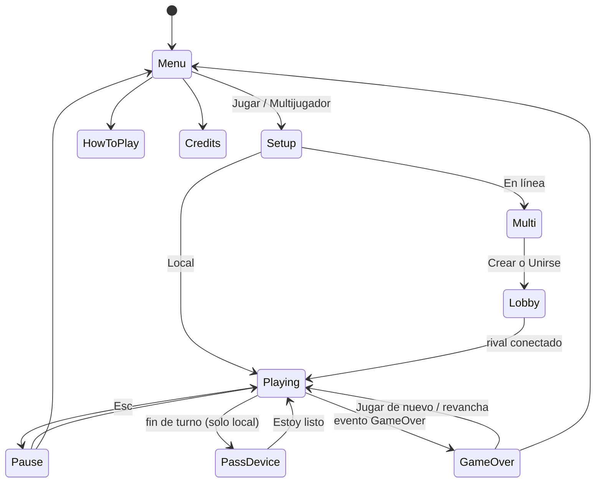
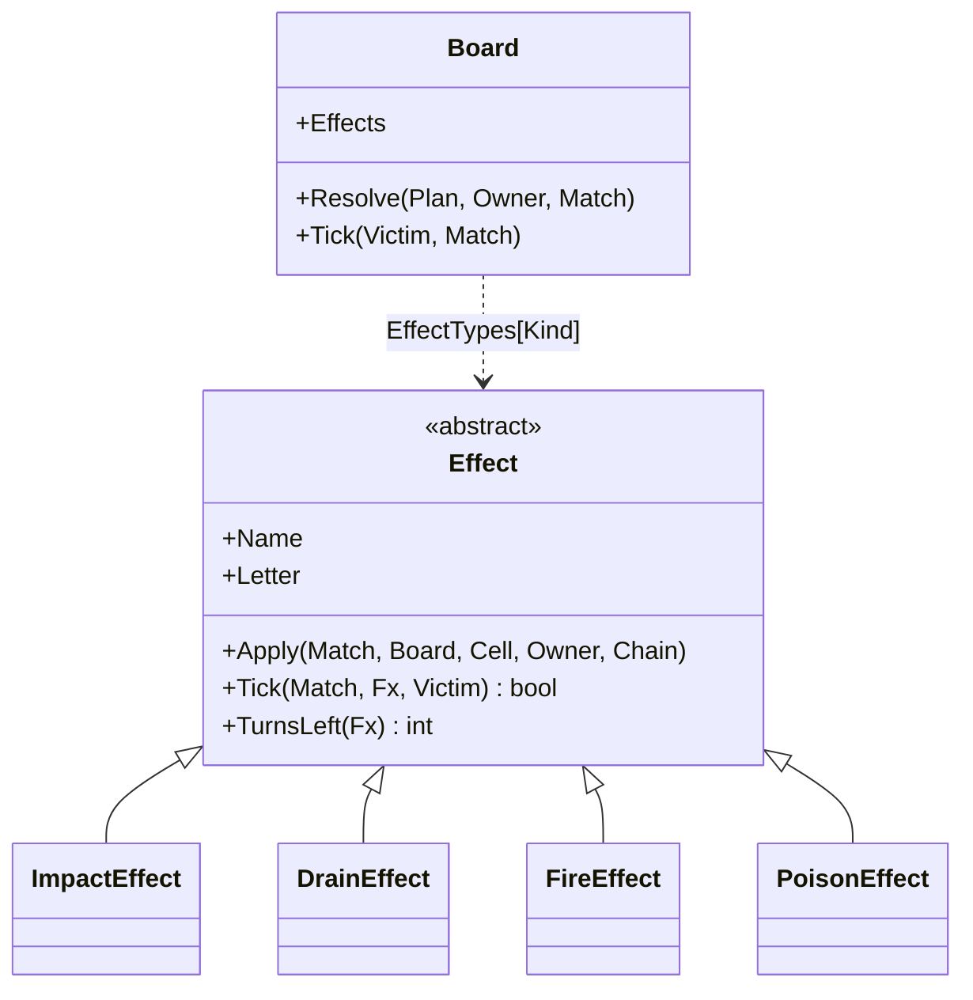
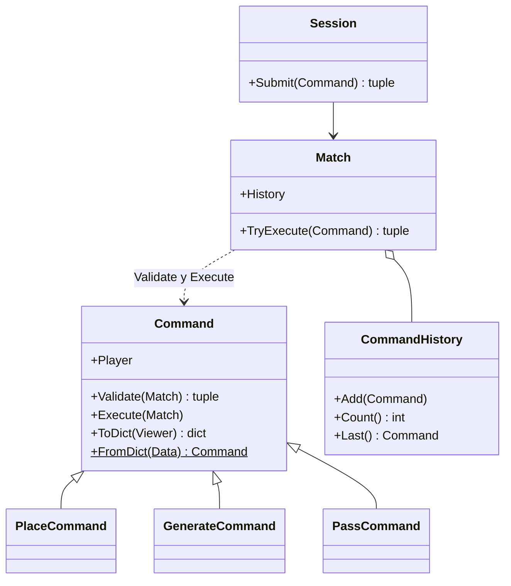
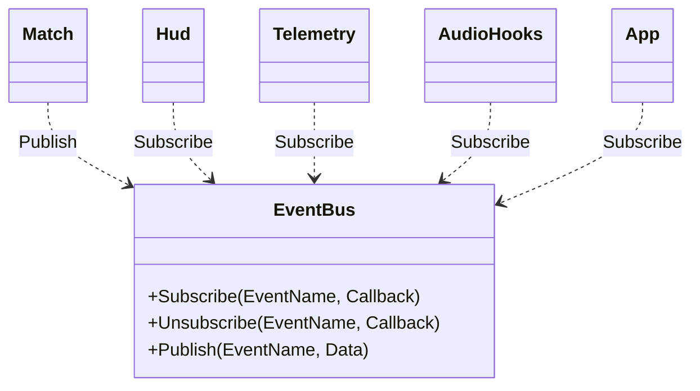
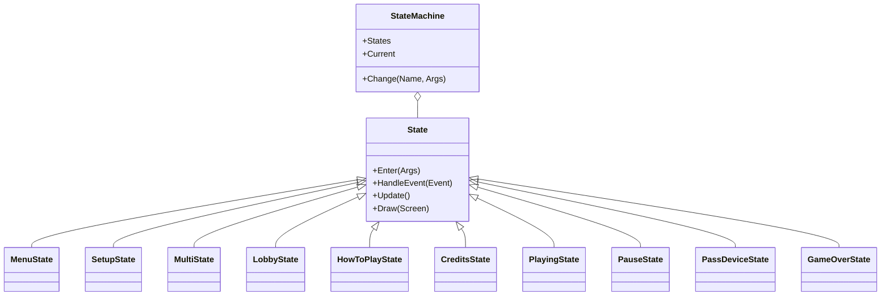
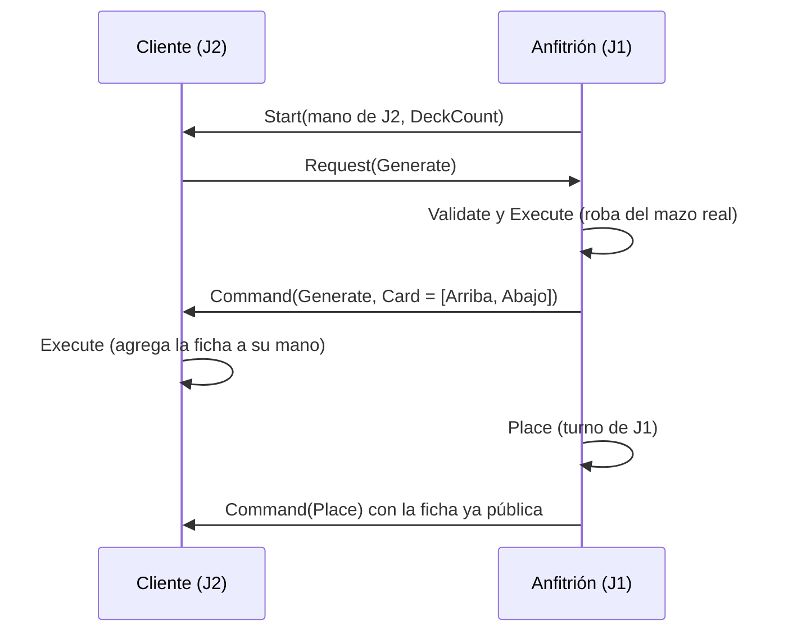

# Witch Hunt: documento de diseño

## 1. Resumen de archivos

**Sin cambios de reglas.** Encadenar, cortar con la mitad de abajo, los efectos Fire, Impact, Drain y Poison y sus números son los mismos que antes.

| Archivo | Estado | Qué cambió y por qué |
|---|---|---|
| `main.py` | Reescrito | Pasó de un monolito con variables globales a 3 líneas. Todo vive en clases. |
| `App.py` | Nuevo | Crea el bus de eventos, las pantallas y la sesión. Tiene el bucle principal. |
| `States.py` | Nuevo | Patrón State: clase base, `StateMachine` y las pantallas Menú, Configuración, Multijugador, Lobby, Cómo jugar y Créditos. |
| `GameStates.py` | Nuevo | Partida, Pausa, "Pasa el dispositivo" y Fin del juego. |
| `Match.py` | Nuevo | Lógica de una partida sin dibujar: turnos, mazo, vida, ganador. Antes estaba en `main.py`. |
| `Commands.py` | Nuevo | Patrón Command: `PlaceCommand`, `GenerateCommand`, `PassCommand` e historial. |
| `Effects.py` | Nuevo | Patrón Strategy: una clase por efecto. |
| `Events.py` | Nuevo | Patrón Observer: `EventBus` y nombres de eventos. |
| `Session.py` | Nuevo | Une `Match` con la red: anfitrión autoritativo, revancha y desconexión. |
| `Board.py` | Cambiado | `Resolve` y `Tick` delegan en las estrategias. `Evaluate` recibe los efectos (ya no una `Card`). Etiquetas J1/J2 en las fichas. |
| `CreateCard.py` | Cambiado | Letra por efecto sobre la ficha, carta oculta, rutas con `ResourcePath`. Se quitó el random infinito. |
| `Deck.py` | Nuevo | Mazo finito y balanceado. |
| `Player.py` | Cambiado | `TakeDamage` y `Heal` devuelven el valor real aplicado. |
| `Network.py` | Sin cambios | Websockets, hilos y envío por lotes estilo Nagle. |
| `Hud.py`, `UI.py` | Nuevos | Números flotantes, aviso de turno, efectos activos, fuentes y botones. |
| `Telemetry.py` | Nuevo | Una fila de CSV por partida. |
| `Audio.py` | Nuevo | Suscripciones listas para música y sonidos. |
| `SkyBox.py` | Cambiado | Precarga los 64 frames una sola vez. |
| `Resources.py` | Nuevo | `ResourcePath`, `WritablePath` y carga única de `data.json`. |
| `data.json` | Cambiado | Se quitaron `TotalPieces` y `AvailableCombinations`. Se agregaron `Deck` y `Credits`. |
| `requirements.txt`, `README.md` | Nuevos | Dependencias y comando de PyInstaller. |

## 2. Navegación entre pantallas



## 3. Strategy: efectos

**Problema.** `Board.Resolve` y `Board.Tick` tenían un `if/elif` por efecto. Agregar un efecto obligaba a editar dos métodos del tablero y mezclaba reglas de daño con reglas de colocación.

**Solución.** Cada efecto es una clase con la misma interfaz. `Board` solo busca la estrategia en `EffectTypes` y la llama.

**Clases participantes:** `Effect` (interfaz), `ImpactEffect`, `DrainEffect`, `FireEffect`, `PoisonEffect` (estrategias concretas) y `Board` (contexto).



```python
# Board.py: antes era un if/elif por efecto
EffectTypes[Item["Effect"]].Apply(Match, self, Cell, Owner, Item["Chain"])

# Effects.py
class FireEffect(Effect):
    def Tick(self, Match, Fx, Victim):
        Fx["Value"] -= 4
        if Fx["Value"] <= 0:
            return True
        Match.DealDamage(Victim, Fx["Value"], "Fire")
        return False
```

Para agregar un efecto nuevo se crea una clase y se registra en `EffectTypes`. `Board` no cambia.

## 4. Command: jugadas

**Problema.** Poner una ficha y generar una estaban repartidas entre `TryPlace`, `GenerateCard`, `ApplyRemotePlace` y `ApplyRemoteGenerate`, con la validación duplicada para local y red. Si una jugada remota era inválida, el estado se desincronizaba sin aviso.

**Solución.** Cada jugada es un objeto que se valida, se ejecuta y se serializa. El mismo objeto sirve para local y en línea. `Match` guarda un historial.

**Clases participantes:** `Command` (base), `PlaceCommand`, `GenerateCommand`, `PassCommand`, `CommandHistory`, `Match` (receptor) y `Session` (quien las envía).



```python
# Match.py
def TryExecute(self, Command):
    Ok, Reason = self.Validate(Command)    # publica InvalidMove si falla
    if not Ok:
        return False, Reason
    Command.Execute(self)
    self.History.Add(Command)
    return True, ""

# Commands.py: lo que viaja por la red
def ToDict(self, Viewer = None):
    Card = None
    if self.CardData is not None and (Viewer is None or Viewer == self.Player):
        Card = list(self.CardData)      # solo se manda la ficha a quien le toca
    return {"Type": self.Type, "Player": self.Player, "Card": Card}
```

`PassCommand` es el tercer comando. Se usa cuando el mazo se acaba (sección 7).

## 5. Observer: eventos

**Problema.** La UI, la telemetría y el futuro audio necesitan enterarse de lo que pasa en la partida. Si `Match` llamara directo a cada uno quedarían acoplados.

**Solución.** `Match`, `Board` y los efectos publican eventos en un `EventBus` sin saber quién escucha. Cada módulo se suscribe por su cuenta.

**Clases participantes:** `EventBus` (sujeto) y como observadores `Hud`, `Telemetry`, `AudioHooks`, `App`, `PlayingState`.

| Evento | Datos | Quién lo publica |
|---|---|---|
| `Damage` | Target, Amount, Source | `Match.DealDamage` |
| `Heal` | Target, Amount, Source | `Match.HealPlayer` |
| `PiecePlaced` | Player, Cells, Upper, Lower | `PlaceCommand` |
| `TurnChanged` | Turn, Player | `Match` |
| `ChainCut` | Player, Cells | `Board.Resolve` |
| `GameOver` | Winner (None es empate), Reason | `Match.Finish` |
| `InvalidMove` | Player, Reason | `Match.Validate` y `Session` |
| `CardDrawn` | Player, DeckCount | `GenerateCommand` |
| `TurnPassed` | Player | `PassCommand` |
| `EffectStarted` | Owner, Kind, Value | Fuego y Veneno |
| `GameStarted` | Mode | `Match` |
| `StateChanged` | Name | `StateMachine` |
| `NetworkError` | Text, Lobby | `Session` |



```python
# Hud.py: la UI reacciona sin que Match sepa que existe
App.Bus.Subscribe(Damage, self.OnDamage)

# Match.py
def DealDamage(self, Target, Amount, Source):
    Real = self.Players[Target].TakeDamage(Amount)
    if Real > 0:
        self.Bus.Publish(Damage, Target = Target, Amount = Real, Source = Source)
```

**Puntos de conexión para audio.** `Audio.py` ya está suscrito a todos los eventos de la tabla. Cada método está vacío. Cuando tengas los sonidos, cárgalos en `AudioHooks.__init__` y llama a `.play()` dentro del método correspondiente. `Source` distingue el efecto (Fire, Impact, Drain, Poison) y `StateChanged` sirve para cambiar la música por pantalla.

## 6. State: pantallas

**Problema.** El string `State` con un `if/elif` por pantalla en el bucle de eventos y otro en el de dibujo hacía que cada pantalla nueva tocara varios lugares de `main.py`.

**Solución.** Cada pantalla es una clase con `Enter`, `HandleEvent`, `Update` y `Draw`. `StateMachine` solo guarda cuál está activa.

**Clases participantes:** `State` (base), `StateMachine` (contexto) y 10 pantallas concretas: `MenuState`, `SetupState`, `MultiState`, `LobbyState`, `HowToPlayState`, `CreditsState`, `PlayingState`, `PauseState`, `PassDeviceState`, `GameOverState`.



```python
# App.py: el bucle ya no sabe que pantallas existen
self.Machine.Current.HandleEvent(Event)
self.Machine.Current.Update()
self.Machine.Current.Draw(self.Screen)

# Otra pantalla se activa con un evento, sin acoplarla a quien lo causa
def OnGameOver(self, Winner, Reason):
    self.Machine.Change("GameOver", Winner = Winner, Reason = Reason)
```

`PauseState` y `GameOverState` dibujan encima de `PlayingState` llamando a su `Draw`. Así la partida sigue visible debajo y la red se sigue procesando, porque `Session.Poll()` corre en el bucle de `App`, no dentro de una pantalla.

## 7. Mazo finito

- **Tamaño:** 32 fichas. Hay 16 combinaciones ordenadas (arriba, abajo) y cada una aparece 2 veces.
- **Balance:** cada efecto aparece 8 veces arriba y 8 veces abajo (16 mitades de 64). Ninguna combinación pesa más que otra.
- **Reparto:** 7 fichas por jugador (14), quedan 18 en el mazo. El contador está en el panel izquierdo y el número de fichas de cada mano junto a ella.
- **Configuración:** `Deck.Effects`, `Deck.CopiesPerCombination` y `Deck.HandSize` en `data.json`.
- **Mazo agotado:** "Generar ficha" pasa a ser "Pasar turno" (`PassCommand`). Si los dos jugadores pasan seguidos, la partida termina y gana quien tenga más vida. Si la vida es igual, es empate. Colocar o generar reinicia la cuenta de pases.

## 8. Mazo en línea sin revelar la mano del rival

**Solución más simple: anfitrión autoritativo.**

1. El anfitrión baraja y reparte. Solo él tiene el mazo real.
2. Al empezar le manda al cliente únicamente **su** mano de 7 fichas y el número de fichas del mazo (`Start`).
3. El cliente guarda la mano del rival como 7 cartas ocultas y el mazo como una lista de `None` (solo sabe cuántas quedan).
4. Para jugar, el cliente envía una petición (`Request`). El anfitrión la valida con el mismo `Command.Validate`, la ejecuta y le devuelve el comando confirmado (`Command`).
5. Si el comando es un `GenerateCommand` del cliente, el anfitrión incluye la ficha robada. Si es del anfitrión, la ficha se omite (`ToDict(Viewer = 1)`).
6. Si la petición es inválida, el anfitrión responde `Reject` y no cambia nada. Por eso no se desincroniza.
7. Si un comando confirmado falla en el cliente, es una desincronización: se avisa con `NetworkError` y se vuelve al menú.



El anfitrión conoce las fichas de ambas manos (las repartió él), pero la interfaz muestra las del rival boca abajo. Un anfitrión modificado podría mirarlas. Para un juego entre amigos y una entrega académica basta. Un servidor dedicado resolvería eso.

**Desconexión y revancha.**
- Si el rival se desconecta durante la partida, `Match.Forfeit` termina la partida y gana el jugador que se queda.
- Revancha: cada lado manda `Rematch`. Cuando ambos aceptaron, el anfitrión baraja de nuevo y envía otro `Start`.

## 9. Retroalimentación visual y accesibilidad

- **Efectos activos:** el panel izquierdo lista, por jugador, los efectos de `Board.Effects` con letra, valor y turnos restantes. `TurnsLeft` lo calcula cada estrategia.
- **Números flotantes:** `Hud` escucha `Damage` y `Heal` y muestra `-8 F` o `+3 D` cerca de la barra del jugador.
- **Aviso de turno:** `Hud` escucha `TurnChanged` y muestra un cartel que se desvanece.
- **Sin depender del color:** cada mitad lleva su letra (F, V, I, D). Cada ficha del tablero lleva la etiqueta J1 o J2, y las barras de vida y las manos también.

## 10. Telemetría

`Telemetry` solo escucha eventos. Al llegar `GameOver` agrega una fila a `Telemetry/partidas.csv` (junto al juego o junto al `.exe`):

`Fecha, Modalidad, DuracionSegundos, Turnos, JugadasInvalidas, FichasGeneradas, Ganador, Motivo`

Si no se puede escribir el archivo, el juego sigue sin avisar. En línea cada equipo guarda su propio registro.

## 11. Rendimiento y empaquetado

- **Skybox:** antes cada cambio de frame abría `data.json` y cargaba un PNG del disco. Ahora `SkyBox` carga los 64 frames una sola vez al abrir. Se guardan a la mitad del tamaño de pantalla para que ocupen unos 60 MB en lugar de unos 245 MB a tamaño completo, y se escalan solo cuando cambia el frame (10 veces por segundo).
- **Rutas:** todo acceso a `Assets/` y `data.json` pasa por `Resources.ResourcePath`, que usa `sys._MEIPASS` cuando corre empaquetado. Lo que el juego escribe (telemetría) usa `WritablePath`.
- **Cache:** `data.json` se lee una sola vez y las imágenes de efectos también.

## 12. Cómo se probó

No tenía pygame ni websockets en mi entorno, así que probé con un pygame falso, sin ventana ni sonido, y con una red simulada en memoria:

- Partida local completa hasta el final, con la pantalla de pasar el dispositivo, el empate por mazo agotado y la fila de telemetría.
- Protocolo en línea entre un anfitrión y un cliente simulados: partida completa con estado idéntico en ambos lados en cada jugada, mano del rival oculta, revancha, rechazo de jugada inválida, detección de desincronización y victoria por desconexión.
- 150 partidas simuladas con jugadas aleatorias para revisar el balance.

**Lo que no se probó:** el dibujo real en pantalla, el clic con mouse en cada botón, y los websockets reales entre dos procesos. Conviene correr dos instancias del juego antes de entregar.
